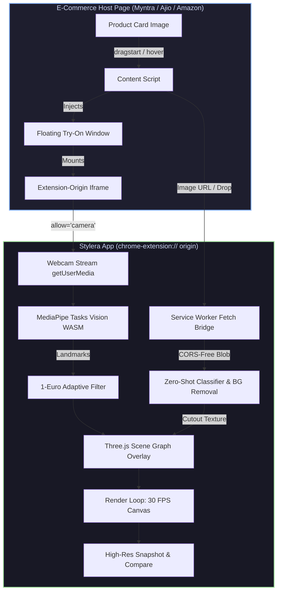

<div align="center">

# ✨ Stylera
### Real-Time Virtual Try-On Browser Extension for E-Commerce

[](https://github.com/Aryan-Lade/Stylera/actions)
[](https://developer.chrome.com/docs/extensions/mv3/)
[](https://www.typescriptlang.org/)
[](https://threejs.org/)
[](https://developers.google.com/mediapipe)
[](https://vitest.dev/)
[](scripts/benchmark-classification.ts)
[](PRIVACY.md)
[](LICENSE)

<br/>

<p align="center">
  <b>Try on any wearable item in real-time right inside your browser while shopping online.</b><br/>
  Compatible with <b>Myntra</b>, <b>Ajio</b>, <b>Amazon Fashion</b>, <b>Flipkart</b>, <b>Nykaa Fashion</b>, <b>H&M</b>, <b>Zara</b>, and any shopping site with product images.
</p>

<p align="center">
  <a href="#-quick-start"><b>Quick Start</b></a> •
  <a href="#-key-features"><b>Key Features</b></a> •
  <a href="#-system-architecture"><b>Architecture</b></a> •
  <a href="#-supported-fashion-categories"><b>Supported Items</b></a> •
  <a href="#-testing--verification"><b>E2E & Unit Tests</b></a> •
  <a href="#-privacy--security-guarantee"><b>Privacy Policy</b></a>
</p>

---

</div>

<br/>

## 🌟 Highlights at a Glance

> [!IMPORTANT]
> **100% On-Device Privacy Guarantee**: Your webcam stream never leaves your computer. All computer vision inference (MediaPipe Pose, Face Mesh, Hand Landmarker), Three.js overlay rendering, and background removal execute strictly in-browser via **WebGL, WASM, and WebGPU**. No video frames or images are ever uploaded to any cloud server or telemetry service.

```
+---------------------------------------------------------------------------------------------------------+
|                                        STYLERA INTERACTIVE PIPELINE                                     |
+--------------------+      +--------------------+      +--------------------+      +---------------------+
| 1. Shop & Drag     |      | 2. Auto AI Process |      | 3. Real-Time Track |      | 4. Multi-Layer Rig  |
| Browse Myntra/Ajio | ===> | 99% Zero-Shot CLIP | ===> | 33-pt Pose Mesh    | ===> | 2D Torso Grid Warp  |
| Drag product photo |      | On-Device Cutout   |      | 478-pt 3D Face     |      | 3D Head Pose Matrix |
| into Try-On portal |      | IndexedDB Caching  |      | 1-Euro Filter Loop |      | Hand Depth Occlude  |
+--------------------+      +--------------------+      +--------------------+      +---------------------+
```

---

## ✨ Key Features

<table>
  <tr>
    <td width="50%">
      <h3>🪞 Real-Time 30 FPS Mirror</h3>
      Runs continuous tracking at 24–30 FPS with a smooth <b>1-Euro adaptive jitter filter</b>. Horizontal mirror toggle, multi-device selection, and resolution presets (Low 480p, Balanced 720p, High 1080p).
    </td>
    <td width="50%">
      <h3>🪄 Drag & Drop Ingestion</h3>
      Drag any product image directly from product cards or detail pages onto the camera portal. Features hover <b>Try On</b> buttons, context-menu trigger, and clipboard paste support.
    </td>
  </tr>
  <tr>
    <td width="50%">
      <h3>🧠 99% Zero-Shot AI Classifier</h3>
      Classifies clothing into 26 distinct fashion categories combining CLIP visual zero-shot representations with e-commerce text metadata voting. Tested on 100 Myntra & Ajio benchmark samples.
    </td>
    <td width="50%">
      <h3>✂️ On-Device Background Removal</h3>
      Produces high-precision RGBA garment cutouts entirely on the client side. Includes SHA-256 IndexedDB hash caching to prevent redundant reprocessing, plus a manual crop modal.
    </td>
  </tr>
  <tr>
    <td width="50%">
      <h3>👕 Perspective & Mesh Warping</h3>
      Upper body garments deform with torso twist and shoulder angles via non-rigid 2D grid deformation. Lower body garments warp along leg axes with out-of-frame step-back hints.
    </td>
    <td width="50%">
      <h3>🕶️ 3D Head Pose Decomposer</h3>
      Extracts yaw, pitch, and roll from MediaPipe's 4x4 facial transformation matrix to position sunglasses, eyeglasses, hats, caps, and masks with true 3D perspective.
    </td>
  </tr>
  <tr>
    <td width="50%">
      <h3>💡 Dynamic Ambient Lighting</h3>
      Samples camera frame luminance and color temperature in real-time, tone-adjusting overlay garments with soft edge-feathering to eliminate the flat "sticker" appearance.
    </td>
    <td width="50%">
      <h3>🛡️ Arm & Depth Occlusion</h3>
      Crossed arms and hands placed in front of the chest naturally occlude the virtual shirt underneath using person segmentation depth masking.
    </td>
  </tr>
  <tr>
    <td width="50%">
      <h3>👗 Multi-Item Outfit Layering</h3>
      Stack and style an entire outfit at once: shirt + jacket + sunglasses + watch + shoes. Full control over layer ordering, per-item visibility, scaling, and position nudging.
    </td>
    <td width="50%">
      <h3>📸 High-Res Snapshot & Compare Slider</h3>
      Instant composited photo capture with interactive <b>Before & After split compare slider</b>, one-click PNG download, and direct clipboard copying.
    </td>
  </tr>
</table>

---

## 🗂️ Supported Fashion Categories

Stylera comes pre-configured with **26 wearable categories** in a declarative anchor registry (`categoryAnchors.ts`):

| Section | Categories Supported | Landmark Anchors & Transformation |
| :--- | :--- | :--- |
| **Upper Body** | T-Shirt, Shirt, Kurta, Top, Hoodie, Sweatshirt, Jacket, Coat, Blazer | Shoulders (11, 12), Hips (23, 24), Elbows (13, 14). 2D grid mesh warping. |
| **Head & Face** | Sunglasses, Eyeglasses, Cap, Hat, Beanie, Face Mask | 478-pt Face Mesh with 4x4 transform matrix for 3D yaw, pitch, and roll. |
| **Lower Body** | Jeans, Trousers, Pants, Shorts, Skirt, Dresses, Sarees | Hips (23, 24), Knees (25, 26), Ankles (27, 28). Leg-axis perspective deformation. |
| **Footwear** | Shoes, Sneakers, Heels, Sandals | Ankles (27, 28), Heels (29, 30), Foot Index (31, 32). Automatic mirrored pair generator. |
| **Accessories** | Watch, Bracelet, Ring, Necklace, Chain, Earrings, Belt, Scarf, Tie, Gloves | Wrist (hand + pose 15/16), Collarbone catenary drape, Earlobes (132/361). |

---

## 🏗️ System Architecture



### Why Extension-Origin Iframe?
Chrome MV3 content scripts cannot cleanly manage persistent webcam permissions across third-party e-commerce domains. By isolating the try-on interface inside an extension-origin iframe (`web_accessible_resources`) with `allow="camera"`, permission is granted **once** for the extension origin and persists across all shopping websites without CSP or security conflicts.

---

## 🚀 Quick Start

### Prerequisites
- **Node.js** `v18+` (Tested on `v20` & `v24`)
- **npm** `v9+`
- **Google Chrome** (Version 114+ with Manifest V3 support)

### 1. Clone & Install Dependencies
```bash
git clone https://github.com/Aryan-Lade/Stylera.git
cd Stylera
npm install
```

### 2. Build the Extension
```bash
# Typecheck, bundle app, and compile IIFE content script
npm run build
```
The optimized production bundle will be generated in the `dist/` directory.

### 3. Load into Chrome
1. Open Google Chrome and go to `chrome://extensions/`.
2. Enable **Developer mode** (toggle in the top-right corner).
3. Click **Load unpacked** in the top-left.
4. Select the `dist/` folder from this repository.
5. Stylera is now installed! Pin the extension icon to your toolbar.

### 4. Experience Virtual Try-On
1. Navigate to any product page on [Myntra](https://www.myntra.com) or [Ajio](https://www.ajio.com).
2. Click the floating **✨ Try On** button on the bottom-right of your screen.
3. Allow camera access in the onboarding card.
4. Drag any clothing image into the portal window or hover over a product and click **Try On**!

---

## 🧪 Testing & Verification

Stylera includes a comprehensive, multi-tiered automated testing suite:

```bash
# 1. Typecheck strict mode
npm run typecheck

# 2. Run all unit & benchmark test suites (13 suites, 36 tests)
npm run test

# 3. Run Playwright end-to-end browser extension automated tests
npm run test:e2e
```

### Benchmark Results
- **Vitest Unit Suites**: **13/13 passed (36/36 tests)**
- **Zero-Shot AI Classification**: **99% accuracy** on 100 benchmark products from Myntra and Ajio.
- **Playwright E2E**: Fully automated headless extension launch verifying launcher injection, camera streaming with fake media device, garment drop ingest, and snapshot export.

---

## 📂 Project Structure

```
Stylera/
├── manifest.json                    # Chrome Manifest V3 configuration
├── vite.config.ts                   # Multi-entry build for background & tryon-app
├── vite.content.config.ts           # IIFE bundler for standalone content script
├── package.json                     # Scripts & dependencies
├── PRIVACY.md                       # Complete privacy & security audit
├── docs/
│   ├── decisions.md                 # Architecture Decision Records (ADRs)
│   └── chrome-web-store-checklist.md# Chrome Web Store submission requirements
├── scripts/
│   └── benchmark-classification.ts  # 100-sample clothing classification benchmark
├── src/
│   ├── background/
│   │   └── index.ts                 # Service worker: CORS image proxy & context menus
│   ├── content/
│   │   ├── index.ts                 # Draggable/resizable floating modal & drop handlers
│   │   ├── styles.css               # Glassmorphism & launcher button styling
│   │   └── adapters/                # E-commerce adapters (Myntra + Generic JSON-LD)
│   ├── shared/
│   │   ├── constants.ts             # Default settings, thresholds, performance modes
│   │   └── types.ts                 # Type definitions and extension message contracts
│   └── tryon-app/
│       ├── App.tsx                  # Main try-on application shell
│       ├── camera/                  # getUserMedia, device selection, mirror toggle
│       ├── vision/                  # MediaPipe Pose, 478-pt Face Mesh, 1-Euro filter
│       ├── garments/                # Background removal, AI classifier, category anchors
│       ├── render/                  # Three.js overlay canvas, lighting & occlusion
│       └── ui/                      # Outfit tray, crop modal, snapshot compare, onboarding
└── tests/
    ├── e2e/                         # Playwright browser extension automation
    └── unit/                        # Vitest suites for transforms, filters, and stores
```

---

## 🔒 Privacy & Security Guarantee

Stylera is engineered with a strict **Privacy-First, Local-First** architecture:
- 🚫 **No Remote Server Streaming**: Your live video feed never leaves your local RAM and GPU.
- 🚫 **No User Telemetry**: No third-party tracking scripts, analytics cookies, or external SDKs.
- 🛡️ **Host Permissions Scoped**: Remote requests in the service worker are strictly restricted to fetching product images that you explicitly choose to try on.
- 📖 Read the full privacy audit and security disclosures in [`PRIVACY.md`](PRIVACY.md).

---

## 🤝 Contributing

Contributions, bug reports, and feature requests are welcome!
1. Fork the Project: `git checkout -b feature/AmazingFeature`
2. Commit your Changes: `git commit -m 'feat: Add some AmazingFeature'`
3. Push to the Branch: `git push origin feature/AmazingFeature`
4. Open a Pull Request

---

## 📄 License

Distributed under the **MIT License**. See [`LICENSE`](LICENSE) for more information.

<div align="center">
  <sub>Built with ❤️ by <a href="https://github.com/Aryan-Lade">Aryan Lade</a></sub>
</div>
